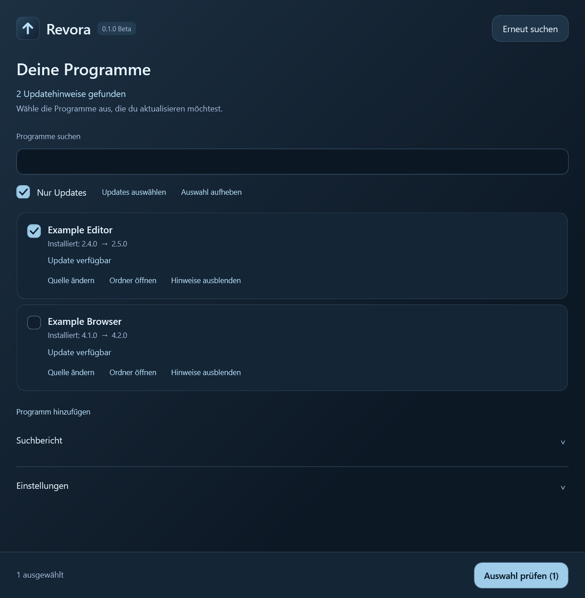

# Revora

**Beta** · Update manager for Windows 10/11 (x64).

Revora checks installed programs for updates. You choose what to update; downloads and installations start only after your confirmation.

*Example view with sample programs.*

- Scan automatically on launch and select individual updates.
- Add or change custom download sources.
- Optionally start with Windows in the background and notify you about updates.
- Turn off update reminders for individual programs.
- Find and install new Revora versions from GitHub without signing in.

**Get started:** Open `Revora.exe` and approve the Windows administrator prompt. Microsoft App Installer with WinGet is required to find installed programs and updates.

Build instructions and contributions: [CONTRIBUTING.md](CONTRIBUTING.md).

## License and legal notices

Project code and icon: [MIT License](LICENSE), provided without warranty as stated in the license. Bundled .NET components and downloaded programs retain their respective licenses. See [third-party notices](THIRD-PARTY-NOTICES.md). WinGet is not bundled.
